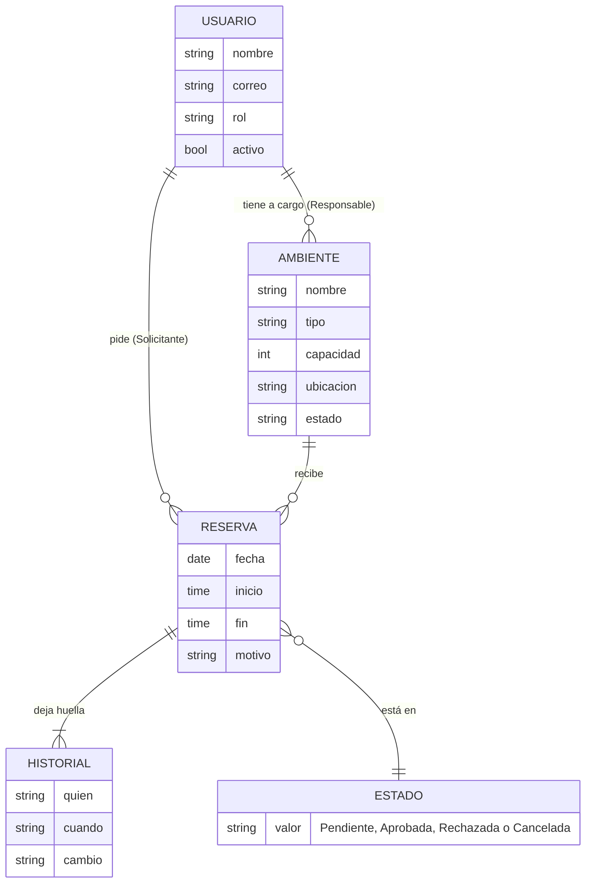
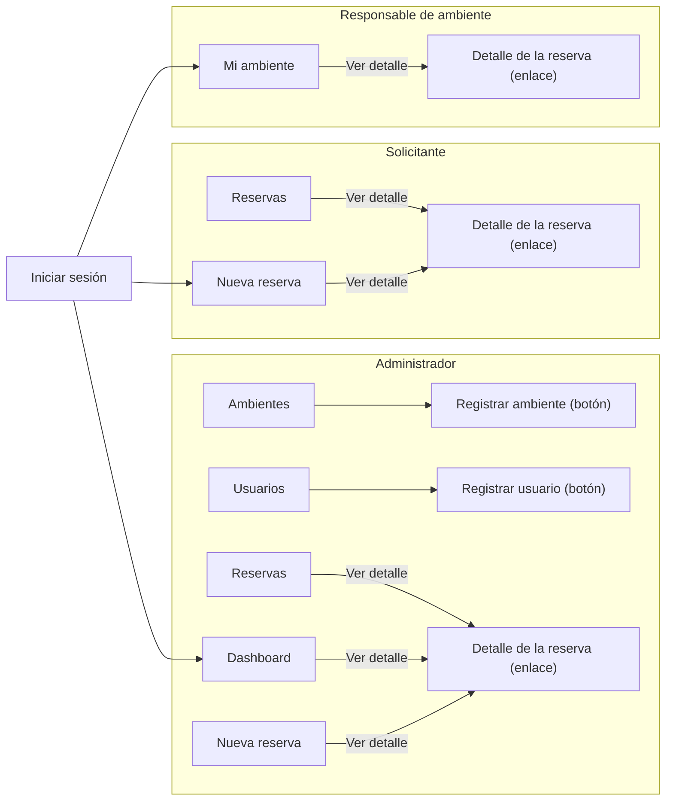

# Arquitectura de información de ReservaUPLA (Fase 8, ampliación)

Cómo está organizado, nombrado y conectado el contenido del sistema **construido**. Todo sale del código (`frontend/src/constants/navegacion.js`, `constants/rutas.js`, `constants/messages.js`, las pantallas) y de las capturas de `docs/evidencias/`; nada es del diseño de Stitch. Las razones de cada nombre y decisión son del equipo de desarrollo: **son hipótesis** hasta que el test de la sección 8b (en `plan-prueba-usuarios.md`) se ejecute con compañeros. No hay resultados de usuarios.

Base: la sección 3 de `contexto-de-uso.md` (mapa por rol y flujos de tareas). Allí queda un enlace a este documento.

## Índice

1. [Organización](#1-organización): por objeto y por rol
2. [Etiquetado](#2-etiquetado): [tabla de etiquetas](#21-tabla-de-etiquetas), [estados y títulos](#22-estados-y-títulos), [incoherencias](#23-consistencia-incoherencias-encontradas), [regla «Nuevo X / Registrar X»](#24-regla-nuevo-x-abre-el-formulario-registrar-x-lo-envía)
3. [Navegación](#3-navegación): global, local, contextual y de utilidad; regreso con filtro y página
4. [Búsqueda y filtros](#4-búsqueda-y-filtros)
5. [Jerarquía de contenido por pantalla](#5-jerarquía-de-contenido-por-pantalla)
6. [Modelo mental](#6-modelo-mental-las-entidades-como-las-entiende-la-persona)
7. [Mapa del sitio](#7-mapa-del-sitio) (generado del código)
8. [Verificación de la estructura](#8-verificación-de-la-estructura): pruebas, diagramas y test de árbol
9. [Principios](#9-principios)

## 1. Organización

**Esquema elegido: por objeto, con la tarea como entrada del menú cuando el objeto tiene una acción frecuente.** Los objetos del dominio son tres, más el cuarto que nace de ellos:

| Objeto | Qué es para la persona | Dónde vive | Quién lo ve |
|---|---|---|---|
| **Reserva** | Una petición de usar un ambiente en una fecha y horas, con estado e historial | `Reservas` (lista), `Nueva reserva` (alta), `Detalle de la reserva`, tarjetas del `Dashboard` | Administrador (todas), Solicitante (las suyas); la Responsable la ve dentro de `Mi ambiente` |
| **Ambiente** | El lugar que se reserva (laboratorio, auditorio, sala) | `Ambientes` (lista y alta), `Mi ambiente` | Administrador (gestiona), Responsable (consulta el suyo); el Solicitante lo elige en `Nueva reserva` |
| **Usuario** | Quien entra al sistema, con un rol | `Usuarios` (lista y alta) | Solo Administrador |
| **Panel** | Resumen de lo anterior | `Dashboard` (Administrador), `Mi ambiente` (Responsable) | Según rol |

**Por qué por objeto y no solo por tarea.** El sistema tiene cinco opciones como máximo en un menú (Administrador), así que cabe a la vista; una agrupación «por tarea» (Pedir, Aprobar, Administrar) obligaría a explicar qué hay dentro de cada grupo. Con sustantivos, la etiqueta del menú es el mismo nombre que ve la persona en el título y en las tablas. La excepción es `Nueva reserva`: es una **tarea** (verbo implícito) y está en el menú porque es lo que más hace la Solicitante (T01) y llegar a ella no debe pasar por una lista. Por eso el menú mezcla objetos (`Reservas`, `Ambientes`, `Usuarios`) y una tarea; es una decisión consciente, no un descuido.

**Agrupación por rol.** El menú no se oculta por «permisos»: cada rol recibe **solo su mundo** (`MENU_POR_ROL`), de uno a cinco ítems y siempre con su pantalla de aterrizaje dentro del menú (lo comprueba `rutas.test.jsx`):

| Rol | Menú lateral (en este orden) | Aterriza en |
|---|---|---|
| Administrador | Dashboard · Reservas · Nueva reserva · Ambientes · Usuarios | Dashboard |
| Solicitante | Reservas · Nueva reserva | Nueva reserva |
| Responsable de ambiente | Mi ambiente | Mi ambiente |

El orden del Administrador va de lo que se **mira** (Dashboard, Reservas) a lo que se **hace** (Nueva reserva) y a lo que se **configura** (Ambientes, Usuarios); la configuración, la menos frecuente, queda al final. Para la Solicitante `Nueva reserva` aterriza primero porque es su tarea principal, pero en el menú va segunda, después de `Reservas`, que es donde comprueba el resultado.

## 2. Etiquetado

La única fuente de textos es `constants/messages.js` (`TEXTOS`, `MENSAJES`); el backend comparte los mensajes de validación. Las razones y alternativas son las del equipo (sección superior).

### 2.1 Tabla de etiquetas

| Etiqueta | Dónde aparece | Qué significa | Por qué este nombre | Alternativa descartada |
|---|---|---|---|---|
| **Dashboard** | Menú (Administrador), título, pestaña | Resumen con cinco indicadores y las solicitudes por atender | Es la palabra que ya usa el diseño (RF-08) y el equipo; se entiende en el contexto universitario | «Panel» o «Inicio»: «Inicio» chocaría con «Volver al inicio», que lleva a la pantalla inicial del rol |
| **Reservas** | Menú (Administrador, Solicitante), título | Lista de reservas, con filtros | Nombre del objeto; mismo término en tablas, filtros e indicadores | «Mis reservas»: sería falso para el Administrador, que ve todas |
| **Nueva reserva** | Menú, título, pestaña | Formulario para pedir un ambiente | Tarea frecuente nombrada por su resultado | «Reservar»: verbo suelto, no distingue de la lista |
| **Ambientes** | Menú (Administrador), título | Lista y alta de laboratorios, auditorios y salas | Término del dominio (`01-analisis.md`) | «Aulas» o «Espacios»: «aula» deja fuera auditorios y laboratorios |
| **Usuarios** | Menú (Administrador), título | Lista y alta de personas con acceso | Término corto y conocido | «Personas» o «Cuentas»: menos usual en un sistema institucional |
| **Mi ambiente** | Menú (Responsable), título | El ambiente que la persona tiene a cargo, con su uso | Posesivo: es *su* ambiente; la persona se reconoce | «Ambiente a mi cargo»: más largo; **limitación conocida O6** (singular aunque pueda tener varios) |
| **Cerrar sesión** | Pie del menú | Termina la sesión y vuelve al login | Verbo + objeto, el estándar | «Salir»: ambiguo (¿salir del sistema o de la pantalla?) |
| **Menú** | Botón de la cabecera en móvil | Abre y cierra el menú lateral | Lo que contiene es el menú | Icono de tres rayas solo: sin texto no se entiende |
| **Iniciar sesión** / **Ingresar** | Título y botón del login | Acceder con correo y contraseña | Título como acción general; botón en una sola palabra | «Entrar» o «Acceder»: equivalentes; se mantuvo el de la maqueta |
| **Mostrar / Ocultar** | Campo de contraseña | Alterna ver la contraseña | Dice lo que hace | «Ojo» (icono): sin texto |
| **¿Olvidaste tu contraseña?** | Login | Abre el aviso «Comunícate con Soporte TI de la universidad» | Pregunta reconocible; el sistema no restablece claves | «Recuperar contraseña»: prometería algo que no hace |
| **Nuevo ambiente / Nuevo usuario** | Botón sobre la lista | Entrar al formulario de alta | Cada lista lleva su alta, con el sustantivo del objeto | «Agregar» o «+»: sin sustantivo, se repite en dos listas |
| **Registrar ambiente / Registrar usuario** | Título del formulario **y** su botón primario | Enviar el alta | «Registrar» es el verbo de la operación y coincide con «Ambiente registrado.» y «Usuario registrado.» (regla en 2.4) | «Crear» o «Guardar»: no coinciden con los mensajes de éxito ni con «Registrar solicitud» |
| **Registrar solicitud** | Botón de Nueva reserva | Enviar el formulario; la reserva nace **Pendiente** | «Solicitud» = reserva todavía sin respuesta; avisa que no está confirmada | «Reservar»: prometería un lugar que aún no está aprobado |
| **Ver detalle** | Cada fila de Reservas, del Dashboard y de Mi ambiente; cierre de Nueva reserva | Abrir la reserva con su historial | Verbo de lectura; el `aria-label` añade ambiente y fecha | «Abrir» o «Ver»: menos descriptivo |
| **Registrar otra solicitud** | Cierre de Nueva reserva | Volver al formulario limpio | Repite el verbo y el sustantivo del botón que acaba de usar (corregido, ver 2.3) | «Nueva reserva» (H07): confundía con el ítem del menú |
| **Limpiar formulario** | Nueva reserva, botón secundario | Vacía los campos sin salir de la pantalla | Dice lo que hace; ya no se llama «Cancelar» (corregido, ver 2.3) | «Cancelar» (se confundía con anular una reserva), «Borrar» |
| **Aprobar / Rechazar** | Detalle y filas del Dashboard (Administrador) | Decidir una solicitud Pendiente | Verbos de decisión; el modal confirma | «Aceptar/Denegar»: «aceptar» se confunde con aceptar un diálogo |
| **Cancelar solicitud / Cancelar reserva** | Detalle: Solicitante (Pendiente) / resto de casos | Anular; estado final Cancelada | «Solicitud» mientras es Pendiente, «reserva» cuando ya es una reserva (corregido, ver 2.3) | «Eliminar»: no se borra nada, queda en el historial |
| **Sí, aprobar / Sí, rechazar / Sí, cancelar reserva** | Botón de confirmar de los modales | Ejecutar la acción | Repite el verbo de la pregunta | «Aceptar»/«Confirmar»: no dicen qué ocurre |
| **Volver** | Botón de los modales y de los formularios de Ambientes y Usuarios | Cerrar el modal, o salir del formulario a su lista sin guardar | Una sola palabra para «sin cambiar nada»; distinta de «Cancelar», que ahora solo anula (corregido, ver 2.3) | «Cancelar» (ambiguo con anular una reserva) |
| **Cancelar** | Solo en el login, mientras verifica | Detener la espera de credenciales | Excepción que se mantiene: no anula una reserva ni descarta datos, solo detiene una petición en curso | «Detener» |
| **Volver a Reservas / Volver al Dashboard / Volver a Mi ambiente** | Enlace sobre el título del detalle | Regresa a la lista (con filtros y página), al Dashboard o a Mi ambiente (con ambiente y página) | Se llama como su destino (corregido, ver 2.3) | «Volver» a secas: no dice adónde |
| **Volver al inicio** | Páginas «Sin permiso» y «No encontramos esa página.» | Lleva a la pantalla inicial del rol | Palabra «inicio» solo aquí | — |
| **Filtros / Filtros (n) · Aplicar filtros · Limpiar · Limpiar filtros** | Reservas | Mostrar los criterios (móvil), aplicarlos, vaciarlos | «(n)» dice cuántos filtros hay activos aunque estén plegados; «Limpiar filtros» solo aparece en el estado vacío | «Buscar»: no hay un campo de texto |
| **Anterior / Siguiente · Página N** | Pie de las listas | Paginación de 10 en 10 | Palabras comunes, con `aria-label` de la región | «<» y «>» |
| **Ver todas las pendientes** | Pie de las solicitudes pendientes del Dashboard | Abre Reservas con el filtro Estado = Pendiente | Dice qué se va a ver (corregido, ver 2.3) | «Ver todas» a secas |
| **Reintentar** | Avisos de error de carga | Repite la petición | Verbo directo | «Actualizar» |

### 2.2 Estados y títulos

| Etiqueta | Dónde aparece | Qué significa | Por qué este nombre | Alternativa descartada |
|---|---|---|---|---|
| **Pendiente** (insignia naranja, reloj) | Tablas, detalle, cierre de Nueva reserva | Esperando respuesta del Administrador | Participio/adjetivo de espera; es el valor del filtro y del indicador «Reservas pendientes» | «En revisión»: sugiere que alguien la está mirando |
| **Aprobada** (verde, marca) | Idem | Confirmada; ocupa el horario (RN-01) | Pareja natural de «Aprobar» | «Confirmada»: no coincide con el botón |
| **Rechazada** (rojo, equis) | Idem | Denegada por el Administrador; estado final (RN-06) | Pareja de «Rechazar» | «Denegada» |
| **Cancelada** (gris, signo menos) | Idem | Anulada por quien la pidió o por el Administrador; final | Pareja de «Cancelar» | «Anulada» |
| **Disponible / En mantenimiento** | Ambientes, Nueva reserva (deshabilitado) | Estado del **ambiente**, no de la reserva | Palabras del uso cotidiano | «Activo/Inactivo» (ya lo usa Usuarios) |
| **Activo / Inactivo** | Usuarios | Si la persona puede entrar | Estado del **usuario** | «Habilitado» |

Las cuatro etiquetas de reserva son siempre un **par verbo-participio** con su botón (Aprobar→Aprobada, Rechazar→Rechazada, Cancelar→Cancelada) y la insignia lleva icono y texto, no solo color.

Títulos (`<h1>` y pestaña del navegador, ver 2.3): Iniciar sesión · Dashboard · Reservas · Nueva reserva · Detalle de la reserva · Ambientes · Registrar ambiente · Usuarios · Registrar usuario · Mi ambiente · Sin permiso · No encontramos esa página.

### 2.3 Consistencia: incoherencias encontradas

Revisé menú, título, botón, mensajes, columnas y tablas contra `messages.js` y las pantallas. **Se corrigieron con TDD (rojo observado antes de implementar)** las que son de texto o de estructura y caben sin cambiar el diseño; el resto queda anotado.

| # | Incoherencia | Dónde | Estado | Prueba que la cubre |
|---|---|---|---|---|
| 46 | «Volver a Reservas» llevaba al **Dashboard** cuando se venía de allí | `DetalleReserva`, `DetalleReservaPage` (texto fijo, además fuera de `messages.js`) | **Corregida**: «Volver al Dashboard» / «Volver a Reservas»; textos en `TEXTOS` | `LayoutYDetalle.test.jsx` (2), `utils/rutaDeRegreso.test.js` |
| 47 | La Solicitante veía «Cancelar solicitud» sobre una reserva **Aprobada** y el modal decía «¿Cancelar esta reserva?» / «Sí, cancelar reserva» | `accionesDeReserva` | **Corregida**: «solicitud» solo mientras está Pendiente; Aprobada y finales dicen «Cancelar reserva» | `utils/reservas.test.js` (3), `DetalleReservaPage.test.jsx` (2) |
| 48 | Tras «Registrar solicitud», el cierre ofrecía «Registrar otra **reserva**» | `TEXTOS.registrarOtra` | **Corregida**: «Registrar otra solicitud» | `formulariosRegistro.test.jsx` |
| 49 | La pestaña del navegador decía «ReservaUPLA» en todas las pantallas (historial, pestañas y lector de pantalla no distinguían) | `index.html` | **Corregida**: «Título · ReservaUPLA» (incluye «Sin permiso» y «No encontramos esa página.») | `utils/tituloDelDocumento.test.js`, `App.test.jsx` |
| 50 | La Responsable podía abrir `/reservas` **escribiendo la dirección** sin que estuviera en su menú y sin «Sin permiso» | `App.jsx` | **Corregida**: la ruta es de Administrador y Solicitante (la Responsable recibe «Sin permiso») | `rutas.test.jsx` (rojo observado) |
| 51 | `contexto-de-uso.md` 3.1 decía que el Administrador aterriza en Ambientes y que la Responsable abre el detalle desde Mi ambiente: ya no es cierto | Documentación | **Corregida**: se reemplaza por un enlace a este documento (mapa generado del código) | `node tools/usabilidad/mapa-del-sitio.mjs --verificar` |
| 52 | **O1.** «Cancelar» significaba tres cosas: salir de un formulario, vaciar Nueva reserva y anular una reserva | `FormularioTarjeta` y los tres formularios | **Corregida**: Ambientes y Usuarios dicen «Volver» y Nueva reserva «Limpiar formulario»; «Cancelar reserva» y «Cancelar solicitud» solo anulan. Queda el «Cancelar» del login (detiene una espera, no anula nada) | `formulariosRegistro.test.jsx`, `etiquetasDeAcciones.test.jsx`, e2e `fase-ai` |
| 53 | **O4.** El botón que envía el alta de un ambiente o un usuario decía «Guardar …», no «Registrar …»: incumplía «Registrar X lo envía» y no coincidía con «Ambiente registrado.» | `AmbienteFormPage`, `UsuarioFormPage` | **Corregida**: «Registrar ambiente» y «Registrar usuario» | `formulariosRegistro.test.jsx`, `etiquetasDeAcciones.test.jsx`, e2e `fase5` y `fase-ai` |
| 54 | **O5.** «Ver todas» no decía qué | Pie del Dashboard | **Corregida**: «Ver todas las pendientes» | `DashboardPage.test.jsx`, e2e `fase9` |
| 55 | **O2.** La Responsable podía abrir el detalle por dirección pero ningún enlace la llevaba | `MiAmbientePage`, `DetalleReservaPage` | **Corregida**: «Ver detalle» por fila (botón secundario), detalle de solo lectura (sin acciones ni aviso) y regreso «Volver a Mi ambiente» con su ambiente y página | `MiAmbientePage.test.jsx`, `DetalleReservaPage.test.jsx`, `rutas.test.jsx` (regla nueva), e2e `fase-ai` |
| 56 | **O3.** En el detalle ninguna opción del menú quedaba marcada | `Layout` | **Corregida**: el menú marca la sección de origen (Reservas por defecto, Dashboard o Mi ambiente), sin migas de pan | `LayoutYDetalle.test.jsx`, `utils/rutaDeRegreso.test.js`, e2e `fase-ai` |

**Limitación conocida (no se corrige):**

- **O6. «Mi ambiente» en singular** aunque la Responsable del ejemplo (Mario Huamán) tiene tres ambientes; dentro de la pantalla hay un selector «Ambiente». El nombre es el de la maqueta y se reconsidera con los resultados del test de la sección 8b.

**Observaciones anteriores, ya resueltas** (O1 a O5): ver las filas 52 a 56.

### 2.4 Regla «Nuevo X abre el formulario; Registrar X lo envía»

«Nuevo» (o «Nueva») es el botón o la opción de menú que **abre** un formulario de alta; «Registrar» es el botón primario del formulario, el que **envía**. El botón secundario del formulario sale sin enviar: «Volver» (a la lista) o «Limpiar formulario» (vacía). «Cancelar» queda solo para anular una reserva (y para detener la espera del login). Comprobación pantalla por pantalla:

| Pantalla | Abre el formulario | Botón que lo envía | Botón que sale sin enviar | Mensaje al terminar |
|---|---|---|---|---|
| Ambientes | «Nuevo ambiente» | «Registrar ambiente» | «Volver» | «Ambiente registrado.» |
| Usuarios | «Nuevo usuario» | «Registrar usuario» | «Volver» | «Usuario registrado.» |
| Nueva reserva (menú) | Opción «Nueva reserva» | «Registrar solicitud» | «Limpiar formulario» | «Solicitud registrada. Quedó Pendiente de aprobación.»; cierre con «Registrar otra solicitud» |

La regla se verificó con `etiquetasDeAcciones.test.jsx` (cada lista abre su formulario y este no tiene ningún botón «Guardar …» ni «Cancelar»; ningún texto de la interfaz empieza con «Guardar»; los únicos textos que empiezan con «Cancelar» son los de anular y el del login) y con el e2e `fase-ai`. Al hacerlo apareció la incoherencia 53: la regla **no se cumplía** (los botones decían «Guardar»), así que se corrigió.

## 3. Navegación

| Tipo | Elementos | Dónde está | Qué hace |
|---|---|---|---|
| **Global** | Menú lateral (`nav` «Principal») con 1 a 5 opciones según el rol; marca de la opción activa | Columna izquierda en escritorio; panel plegable con el botón **Menú** en móvil | Lleva a cada pantalla principal; la opción activa se marca (las de `exacta: false` también en sus subpantallas); **en el detalle de una reserva marca la sección de origen** (Reservas por defecto, Dashboard o Mi ambiente, con `aria-current="true"`); no hay migas de pan |
| **Local** | Filtros de Reservas (Estado, Ambiente, Fecha desde, Fecha hasta), «Aplicar filtros», «Limpiar»; paginación «Anterior/Siguiente»; selector de ambiente de `Mi ambiente` | Encima y debajo de la tabla de la pantalla | Cambia lo que muestra la **misma** pantalla; el estado va en la dirección (`?estado=Pendiente&pagina=2`) |
| **Contextual** | «Ver detalle» (filas de Reservas, Dashboard y Mi ambiente; cierre de Nueva reserva); «Ver todas las pendientes»; «Volver a Reservas» / «Volver al Dashboard» / «Volver a Mi ambiente»; «Nuevo ambiente», «Nuevo usuario»; «Volver» de los formularios de Ambientes y Usuarios | Dentro de la pantalla, junto al contenido al que se refiere | Va a una pantalla **relacionada** que no está en el menú, o regresa |
| **De utilidad** | «Cerrar sesión»; nombre y rol de quien tiene la sesión; «¿Olvidaste tu contraseña?» (login) | Pie y cabecera del menú | Sesión y ayuda, fuera del flujo de tareas |

**Regreso con filtro y página conservados.** Reservas pasa su dirección completa en el estado del router (`state.volverA = /reservas?estado=Pendiente&pagina=2`) al abrir un detalle, y el enlace «Volver a Reservas» regresa **exactamente** a esa lista; desde el Dashboard el estado es `/dashboard` y el enlace se llama «Volver al Dashboard». Mi ambiente hace lo mismo con su dirección (`/mi-ambiente?ambienteId=1&pagina=2`) y el enlace dice «Volver a Mi ambiente». Un origen que no está en el menú del rol se ignora; si se abre el detalle escribiendo la dirección, el regreso es la primera pantalla de origen de su menú (Reservas, o Mi ambiente para la Responsable). Como el filtro está en la URL, «atrás» del navegador y compartir el enlace también funcionan. Pruebas: `ReservasPage.test.jsx`, `DashboardPage.test.jsx`, `MiAmbientePage.test.jsx`, `LayoutYDetalle.test.jsx`, `utils/rutaDeRegreso.test.js`, `e2e fase9` y `e2e fase-ai`.

**Recorrido típico del Administrador (T03):** Dashboard → «Ver detalle» → «Volver al Dashboard», o Dashboard → «Aprobar» (modal) sin salir. Desde Reservas: Reservas (filtro Pendiente) → «Ver detalle» → «Aprobar» → «Volver a Reservas» (misma página y filtro). **De la Responsable:** Mi ambiente → «Ver detalle» → «Volver a Mi ambiente» (mismo ambiente y página).

## 4. Búsqueda y filtros

| Pantalla | Se puede filtrar por | Por qué ese criterio |
|---|---|---|
| Reservas | **Estado** (Todos, Pendiente, Aprobada, Rechazada, Cancelada), **Ambiente**, **Fecha desde** y **Fecha hasta** (dd/mm/aaaa) | Son las tres preguntas que se hacen a una lista de reservas: «¿en qué estado está?» (T03, T09), «¿de qué lugar?» y «¿cuándo?». Cubren T03, T04 y T09 con 1 a 3 interacciones |
| Mi ambiente | **Ambiente** (si tiene más de uno) y página | Evita que la Responsable vea lo ajeno; no necesita más criterios |
| Ambientes, Usuarios | Nada (lista completa) | Hoy hay pocas filas: ver todo es más rápido que filtrar |

El orden siempre es por fecha y la página es de 10 filas; un rango de fechas inválido da «La fecha final no puede ser anterior a la inicial.». «Todos» y los campos vacíos no filtran. El filtro es una **consulta a la API**, no se filtra en el navegador.

**Por qué no hay buscador global.** Hay 12 direcciones y 6 opciones de menú entre los tres roles (5 como máximo para uno) y los objetos que se buscan (reservas, ambientes, usuarios) viven cada uno en una lista con su propio filtro o con pocas filas. Un buscador global añadiría una caja que ocupa espacio y exige decidir *qué* devuelve (¿una reserva por motivo? ¿un ambiente por nombre?) a cambio de ahorrar uno o dos clics. Se reconsideraría si el número de ambientes o usuarios creciera de modo que las listas dejaran de caber en una o dos páginas, o si la prueba con usuarios mostrara que buscan reservas por el motivo o el solicitante (hoy no hay filtro de texto).

## 5. Jerarquía de contenido por pantalla

Lo que se ve **primero, segundo y tercero** en 1280 px. Capturas citadas de `docs/evidencias/`.

**Login** — [`fase8/despues/01-login-vacio`](../evidencias/fase8/despues/01-login-vacio-escritorio.png)

| Orden | Qué ve | Por qué |
|---|---|---|
| 1 | Título «Iniciar sesión» y, a la izquierda, «ReservaUPLA» con su lema | Dice dónde está y de qué sistema |
| 2 | Campos Correo institucional (con ejemplo) y Contraseña con «Mostrar» | Es lo único que se llena |
| 3 | «Ingresar» (primario, ancho) y debajo «¿Olvidaste tu contraseña?» | Una sola acción principal; la ayuda no compite |

**Dashboard (Administrador)** — [`fase-ai/07-dashboard-pendientes`](../evidencias/fase-ai/07-dashboard-pendientes-escritorio.png)

| Orden | Qué ve | Por qué |
|---|---|---|
| 1 | Título y cinco tarjetas: total (con «Incluye canceladas»), pendientes, aprobadas, rechazadas, ambiente más utilizado | La primera pregunta es «cómo está el sistema» (T10); el número grande va arriba |
| 2 | Tabla de solicitudes pendientes más antiguas (fecha, horario, ambiente, solicitante) | Es el trabajo por hacer, ordenado por antigüedad |
| 3 | Acciones por fila: «Ver detalle», «Rechazar», **«Aprobar»** (primario, a la derecha); pie «Mostrando N de M» y «Ver todas las pendientes» | Decidir sin salir; el primario más a la derecha, como en los formularios |

**Reservas** — [`fase9/04-reservas-filtro-aprobada`](../evidencias/fase9/04-reservas-filtro-aprobada-escritorio.png)

| Orden | Qué ve | Por qué |
|---|---|---|
| 1 | Título «Reservas» y la tarjeta de filtros (Estado, Ambiente, fechas); «Aplicar filtros» es el primario | Se filtra antes de leer; en móvil se pliega tras «Filtros (n)» |
| 2 | Tabla: Fecha, Horario, Ambiente, Solicitante (**solo Administrador**), Estado (insignia) | La Solicitante solo ve las suyas: su nombre en cada fila sería ruido |
| 3 | «Ver detalle» por fila; pie «Mostrando N de M» y paginación | La acción es de lectura; el total orienta |

**Nueva reserva (Solicitante y Administrador)** — [`fase-ai/01-nueva-reserva-formulario`](../evidencias/fase-ai/01-nueva-reserva-formulario-escritorio.png), cierre: [`02-nueva-reserva-cierre`](../evidencias/fase-ai/02-nueva-reserva-cierre-escritorio.png)

| Orden | Qué ve | Por qué |
|---|---|---|
| 1 | Título y «Ambiente» con capacidad y ubicación como ayuda | Elegir *dónde* es lo primero y condiciona lo demás (también la disponibilidad) |
| 2 | Fecha (ya con hoy), Hora de inicio y Hora de fin con el aviso de disponibilidad | Los campos que determinan el conflicto (RN-01), juntos |
| 3 | Motivo y, al pie, «Limpiar formulario» y **«Registrar solicitud»** | Lo que se escribe a mano va al final; el primario a la derecha |
| Cierre | Mensaje verde, resumen (Ambiente, Fecha, Horario, Estado Pendiente), «Ver detalle» y «Registrar otra solicitud» | Confirma y propone el siguiente paso |

**Detalle de la reserva (todos los roles)** — [`fase-ai/03-detalle-solicitante-pendiente`](../evidencias/fase-ai/03-detalle-solicitante-pendiente-escritorio.png), [`04-…aprobada`](../evidencias/fase-ai/04-detalle-solicitante-aprobada-escritorio.png), [`06-detalle-responsable`](../evidencias/fase-ai/06-detalle-responsable-escritorio.png), [`08-detalle-desde-dashboard`](../evidencias/fase-ai/08-detalle-desde-dashboard-escritorio.png)

| Orden | Qué ve | Por qué |
|---|---|---|
| 1 | «← Volver a Reservas» (o «Volver al Dashboard» / «Volver a Mi ambiente») y el título; en el menú, la sección de origen marcada | Dónde estoy y cómo regreso |
| 2 | Datos (Ambiente, Solicitante, Fecha, Horario, Motivo, Estado con insignia) y un aviso si la reserva es final | Qué es esta reserva y en qué estado está |
| 3 | Historial y, abajo, las acciones **según rol y estado**: Administrador «Cancelar reserva · Rechazar · Aprobar»; Solicitante «Cancelar solicitud» (Pendiente) o «Cancelar reserva»; Responsable **ninguna y sin aviso** (solo lectura) | Primero entender, después actuar; RN-05 y RN-06 deciden qué botones hay |

**Ambientes y Usuarios (Administrador)** — [`fase8/despues/10-ambientes-listado`](../evidencias/fase8/despues/10-ambientes-listado-escritorio.png)

| Orden | Qué ve | Por qué |
|---|---|---|
| 1 | Título a la izquierda y «Nuevo ambiente» / «Nuevo usuario» (primario) a la derecha | La acción de alta está donde se mira el título |
| 2 | Tabla: Ambientes (Nombre, Tipo, Capacidad, Ubicación, Estado, Responsable) · Usuarios (Nombre, Correo, Rol, Estado) | Datos de identificación primero, estado y responsable al final |
| 3 | Insignias de estado con icono y texto | El estado se lee sin depender del color |

**Registrar ambiente / usuario** — [`fase-ai/09-ambiente-formulario`](../evidencias/fase-ai/09-ambiente-formulario-escritorio.png), [`10-usuario-formulario`](../evidencias/fase-ai/10-usuario-formulario-escritorio.png)

| Orden | Qué ve | Por qué |
|---|---|---|
| 1 | Título «Registrar …» | El verbo de la operación |
| 2 | Ambiente: Nombre, Tipo, Capacidad, Ubicación, Estado, Responsable · Usuario: Nombre completo, Correo institucional, Rol, Activo, Contraseña inicial | De lo que identifica a lo que configura; la contraseña, al final, con su regla |
| 3 | «Volver» y **«Registrar ambiente» / «Registrar usuario»** | Un solo primario, a la derecha; el secundario no cambia nada |

**Mi ambiente (Responsable)** — [`fase-ai/05-mi-ambiente`](../evidencias/fase-ai/05-mi-ambiente-escritorio.png) (375 px: [`05-mi-ambiente-movil`](../evidencias/fase-ai/05-mi-ambiente-movil.png))

| Orden | Qué ve | Por qué |
|---|---|---|
| 1 | Título, nombre del ambiente con Ubicación y Capacidad, y el selector «Ambiente» si tiene más de uno | Reconoce *su* ambiente antes de ver números |
| 2 | Cuatro tarjetas: total (con «Incluye canceladas»), pendientes, aprobadas, rechazadas | Cuánto uso tiene (extensión del diseño 08, por validar) |
| 3 | Tabla: Fecha, Horario, Solicitante, Estado y «Ver detalle» por fila; pie «Mostrando N de M» | Solo lectura: el único botón abre el detalle, sin aprobar ni rechazar |

**Sin permiso / No encontramos esa página.** `h1`, un texto y «Volver al inicio» (misma estructura, `ErrorRutaPage`); dentro del menú del rol, para no perder la orientación.

## 6. Modelo mental: las entidades como las entiende la persona



| Entidad | Cómo la entiende la persona | Cómo se refleja en la interfaz |
|---|---|---|
| **Usuario** | «Yo» (nombre y rol arriba del menú) y «las personas del sistema» | Cabecera del menú; `Usuarios`; columna «Solicitante» y «Responsable» |
| **Ambiente** | «El lugar»: lo que se pide y lo que se cuida | Selector de Nueva reserva, `Ambientes`, `Mi ambiente`, columna «Ambiente»; estado propio (Disponible / En mantenimiento) |
| **Reserva** | «Mi pedido» con fecha, horas y motivo | `Nueva reserva`, `Reservas`, `Detalle de la reserva`, tarjetas del Dashboard |
| **Estado** | «En qué va mi pedido»; se mueve en una sola dirección (Pendiente → Aprobada, Rechazada o Cancelada; Aprobada → Cancelada; finales: Rechazada y Cancelada) | Insignia con icono y texto en tablas y detalle; filtro «Estado»; botones habilitados según estado (RN-05/06) |
| **Historial** | «Qué pasó y quién lo hizo» | Lista bajo el detalle: «Solicitud registrada por Ana Torres, 04/11/2026 11:49», «Reserva aprobada por …» |

El vocabulario conecta dos palabras: **solicitud** es una reserva que todavía no tiene respuesta (Pendiente: «Registrar solicitud», «Solicitud registrada», «Solicitudes pendientes de aprobación», «Cancelar solicitud»); **reserva** es el objeto con cualquier estado («Reservas», «Detalle de la reserva», «Cancelar reserva»). Las incoherencias 47 y 48 eran violaciones de esa regla.

## 7. Mapa del sitio

Generado por `node tools/usabilidad/mapa-del-sitio.mjs --escribir` desde `constants/rutas.js` y `navegacion.js`; **no se edita a mano**. `--verificar` falla si no coincide con el código.

<!-- MAPA:inicio -->

| Dirección | Pantalla | Roles que pueden entrar | Lo ve en su menú | Cómo se llega |
|---|---|---|---|---|
| `/login` | Iniciar sesión | Sin sesión (pública) | — | Dirección o cierre de sesión |
| `/` | Redirige a la pantalla inicial del rol (o a `/login`) | Cualquiera | — | Dirección |
| `/dashboard` | Dashboard | Administrador | Administrador | Menú lateral |
| `/ambientes` | Ambientes | Administrador | Administrador | Menú lateral |
| `/ambientes/nuevo` | Registrar ambiente | Administrador | — | Botón dentro de la pantalla del menú |
| `/usuarios` | Usuarios | Administrador | Administrador | Menú lateral |
| `/usuarios/nuevo` | Registrar usuario | Administrador | — | Botón dentro de la pantalla del menú |
| `/reservas/nueva` | Nueva reserva | Administrador, Solicitante | Administrador, Solicitante | Menú lateral |
| `/reservas` | Reservas | Administrador, Solicitante | Administrador, Solicitante | Menú lateral |
| `/reservas/:id` | Detalle de la reserva | Administrador, Solicitante, Responsable de ambiente | — | Enlace desde `/reservas`, `/dashboard`, `/reservas/nueva`, `/mi-ambiente` |
| `/mi-ambiente` | Mi ambiente | Responsable de ambiente | Responsable de ambiente | Menú lateral |
| `*` | No encontramos esa página. | Con sesión | — | Dirección que no existe |



<!-- MAPA:fin -->

## 8. Verificación de la estructura

**a) Pruebas automatizadas** (rojo observado antes de implementar, ver incoherencias 50 a 56):

- `frontend/src/rutas.test.jsx` (27): toda ruta protegida declara roles válidos; no hay direcciones repetidas y todas tienen título; cada opción de `MENU_POR_ROL` apunta a una ruta que **existe** y a la que ese rol **puede entrar**; cada rol aterriza en una opción de su menú; un rol no puede abrir por dirección una pantalla ajena a su menú (salvo subpantallas de una opción y las contextuales); **cada rol que entra a una ruta contextual tiene, en su menú, una pantalla desde la que se llega** (la regla que habría detectado O2); y, para cada rol y cada ruta que no le corresponde, la pantalla es «Sin permiso» (lo que demuestra además que la ruta existe en el router).
- `frontend/src/etiquetasDeAcciones.test.jsx` (5): la regla «Nuevo X / Registrar X» y que «Cancelar» solo anula (2.4).
- `frontend/src/utils/rutaDeRegreso.test.js` (9), `LayoutYDetalle.test.jsx`, `MiAmbientePage.test.jsx`, `DetalleReservaPage.test.jsx`, `utils/tituloDelDocumento.test.js` (4): regreso, sección marcada del menú, «Ver detalle» de Mi ambiente, detalle de solo lectura y título de la pestaña.
- `tools/usabilidad/pruebas/mapa.test.mjs` y `mermaid.test.mjs`: la tabla del mapa trae todas las rutas, el diagrama conecta el login con la pantalla de aterrizaje y los diagramas de `docs/` se encuentran.
- `tools/e2e/fase-ai.mjs` (`npm run faseai`): las mismas comprobaciones por la interfaz real a 1280 px y 375 px, con las capturas de `docs/evidencias/fase-ai/`. Accesibilidad de esas pantallas (axe, objetivos de 44 px, contraste, teclado): `docs/evidencias/fase-ai-accesibilidad.txt`.
- Límite: el frontend orienta; quien decide es la API (403).

**Diagramas Mermaid.** `cd tools/usabilidad && npm run mermaid` (`node validar-mermaid.mjs`) renderiza a SVG, en Edge sin ventana, **todos** los bloques ```mermaid de `docs/` y del README, y falla si alguno no se renderiza. Resultado de la última corrida: 5 de 5 diagramas renderizados (los de este documento y los de `contexto-de-uso.md`); con un bloque roto a propósito el validador lo reportó (`Parse error`) y se quitó.

**b) Test de tarjetas inverso (tree test):** 5 preguntas con ruta correcta y hoja de registro en `plan-prueba-usuarios.md`, sección 10. **No se ha ejecutado**: no hay resultados.

## 9. Principios

Las filas de Nielsen N2, N4 y N6 y de Shneiderman S1 y S8 que citan estas etiquetas, la navegación y la jerarquía están en `matriz-principios-final.md` («Arquitectura de información»).
