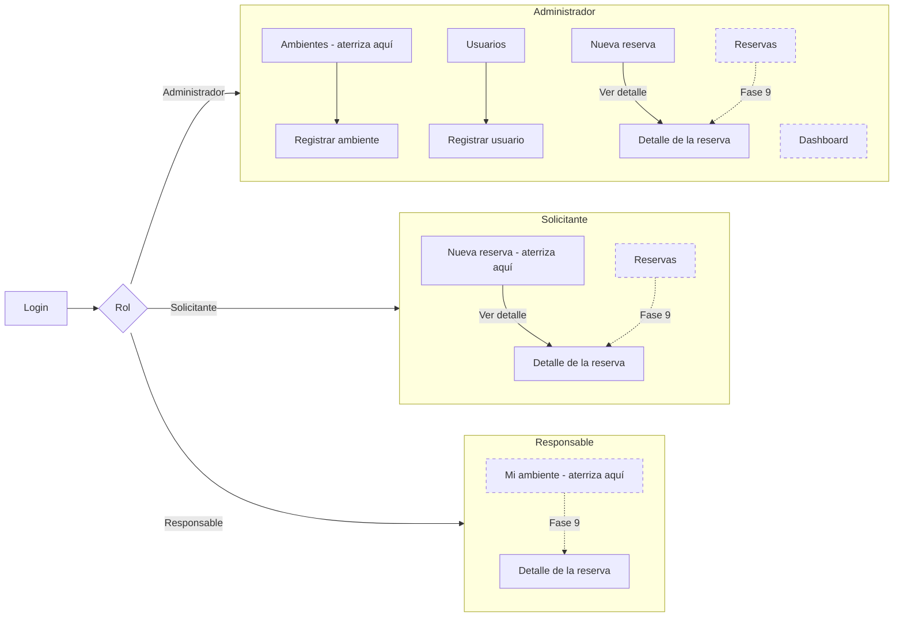
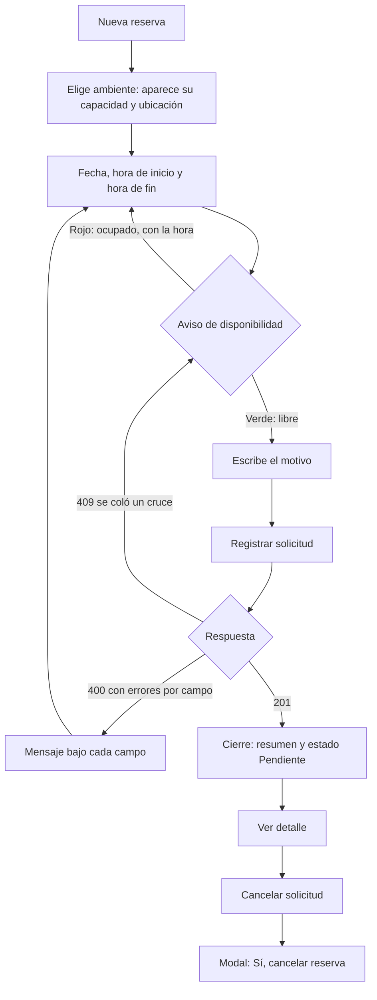
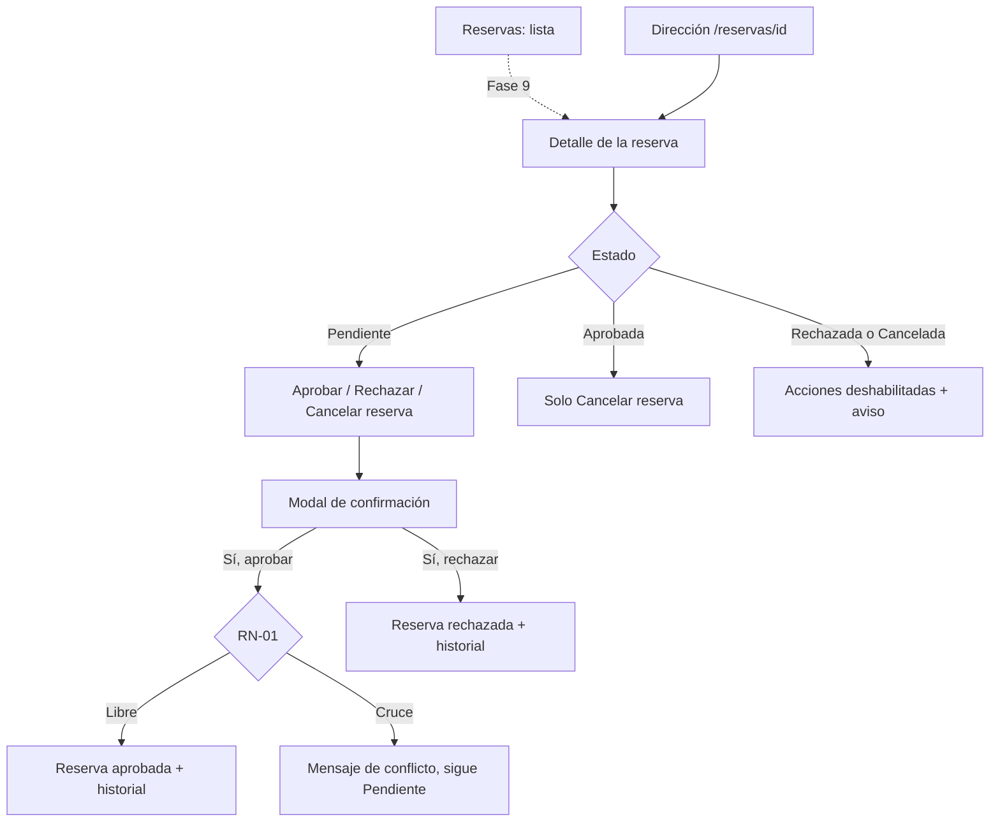
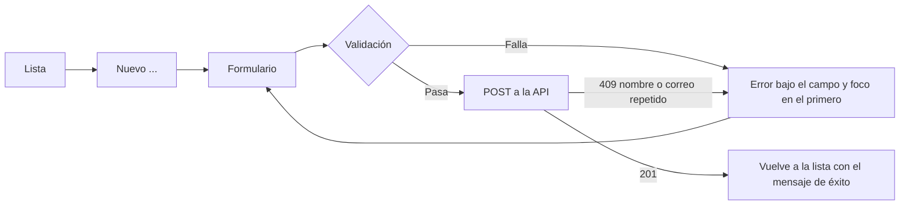

# Contexto de uso y arquitectura de información (Fase 8, paso 1)

Proceso de diseño centrado en el usuario (ISO 9241-210), actividades 1 («comprender y especificar el contexto de uso») y 2 («especificar los requisitos del usuario»). Todo lo que sigue describe el sistema **construido** (Fases 5 a 7), no las imágenes de Stitch.

> **Qué es dato y qué es hipótesis.** Las tres personas de la sección 1 **no vienen de entrevistas ni de observación**: son hipótesis razonadas a partir del caso práctico (`docs/01-analisis.md`) y deben validarse con compañeros o con el ingeniero antes de usarse como fundamento. Los números de clics de la sección 2 sí son medibles: salen de contar los pasos de la interfaz real.

## 1. Personas (HIPÓTESIS a validar)

| | Carla, Administradora | Ana, Solicitante | Mario, Responsable de ambiente |
|---|---|---|---|
| Quién es (hipótesis) | Personal administrativo de la universidad que decide qué solicitudes se aprueban. | Docente que necesita un laboratorio, auditorio o sala para una clase o actividad. | Encargado de uno o varios ambientes; quiere saber cuándo se usan. |
| Objetivo | Aprobar o rechazar rápido, sabiendo que no va a haber dos reservas aprobadas que se crucen; mantener al día ambientes y usuarios. | Pedir un ambiente, saber **antes de enviar** si está libre y no tener que volver a preguntar por mensaje. | Ver las reservas de su ambiente sin poder aprobarlas ni modificarlas. |
| Frustraciones (hipótesis, del caso: duplicidad, pérdida de solicitudes, falta de trazabilidad) | No saber quién pidió qué ni cuándo; descubrir un cruce cuando ya prometió el ambiente. | Enterarse del cruce tarde; no saber si su solicitud llegó; perder una solicitud enviada por mensaje. | No tener una vista única de la disponibilidad real. |
| Dispositivo y situación | Computadora de escritorio en una oficina, sesiones largas, varias tareas seguidas. | Teléfono entre clases o computadora en la sala de docentes; tareas cortas y a veces apuradas. | Teléfono o computadora; consultas breves y ocasionales. |
| Qué le importa al diseño | Pocas confirmaciones erróneas, mensajes de conflicto claros, tablas legibles. | Formulario corto, aviso inmediato de disponibilidad, que funcione a 375 px con el pulgar. | Pantalla de solo lectura, sin botones que no puede usar. |
| Rol en el sistema | Aprueba, rechaza, cancela; gestiona usuarios y ambientes (RN-05). | Crea reservas; cancela solo las suyas, Pendientes o Aprobadas. | Solo lectura de las reservas de su ambiente. |

**Qué falta para validarlas:** hablar con 2 o 3 personas por rol (compañeros que hagan de docente, y el ingeniero para el rol administrativo) y anotar qué tareas hacen hoy, con qué dispositivo y qué les molesta. Hasta entonces, cualquier afirmación de «el usuario quiere…» en estos documentos es hipótesis.

## 2. Tareas T01 a T10

«Interacciones mínimas» = el camino más corto con la interfaz actual: cada clic o toque en un control, cada opción elegida en una lista y cada campo en el que hay que entrar para escribir cuentan 1. **No** se cuentan las pulsaciones de teclas al escribir. Una lista nativa (`<select>`) cuesta 2: abrir y elegir. Se asume que la persona ya tiene la sesión iniciada y está en la pantalla donde aterriza.

| Id | Rol | Tarea | Pasos esperados | Interacciones mínimas | Estado |
|---|---|---|---|---|---|
| T01 | Solicitante | Registrar una reserva | 1 Ambiente (2). 2 Fecha: ya viene escrita con hoy (0); otra fecha, 1 para entrar y escribir `ddmmaaaa`. 3 Hora de inicio (2). 4 Hora de fin (2). 5 Motivo (1). 6 «Registrar solicitud» (1). Se ve el aviso de disponibilidad antes de enviar y el resumen al terminar. | **8** con la fecha de hoy; **9** con otra fecha | **Existe** |
| T02 | Solicitante | Cancelar su solicitud | Desde el cierre de T01: «Ver detalle» (1), «Cancelar solicitud» (1), «Sí, cancelar reserva» (1). Para llegar a una reserva antigua haría falta la lista de Reservas. | **3** desde el cierre de T01 | **Parcial**: la acción existe; encontrar una reserva ya registrada espera la lista de Reservas (Fase 9) |
| T03 | Administrador | Aprobar una reserva | «Reservas» (1), fila «Ver detalle» (1), «Aprobar» (1), «Sí, aprobar» (1). | **4** | **Parcial**: detalle y confirmación existen; la lista para llegar a la reserva espera a la Fase 9 (hoy solo por la dirección `/reservas/<id>`) |
| T04 | Administrador | Rechazar una reserva | «Reservas» (1), «Ver detalle» (1), «Rechazar» (1), «Sí, rechazar» (1). | **4** | **Parcial**, por lo mismo que T03 |
| T05 | Administrador y Solicitante | Detectar un conflicto de horario | Solicitante: elegir ambiente, fecha y horas y ver el aviso rojo con la hora ocupada, sin pulsar nada más. Administrador: al aprobar una reserva que se cruza con una aprobada ve el mismo mensaje (409). | **0** extra para el Solicitante; **0** extra para el Administrador (lo ve al intentar T03) | **Existe** |
| T06 | Administrador | Registrar un ambiente | «Nuevo ambiente» (1), Nombre (1), Tipo (2), Capacidad (1), Ubicación (1), Estado (2), Responsable (2), «Guardar ambiente» (1). | **11** | **Existe** |
| T07 | Administrador | Registrar un usuario | «Usuarios» en el menú (1), «Nuevo usuario» (1), Nombre (1), Correo (1), Rol (2), Contraseña inicial (1), «Guardar usuario» (1). «Activo» ya viene encendido. | **8** | **Existe** |
| T08 | Responsable | Consultar su ambiente | «Mi ambiente» en el menú, que debería listar las reservas de su ambiente. | 1 (estimado) | **Espera a la Fase 9**: hoy muestra «Pantalla en construcción» |
| T09 | Administrador (y los demás roles) | Filtrar reservas | «Reservas» (1), elegir filtros (estimado 2 a 4), «Aplicar» (1). | 4 a 6 (estimado) | **Espera a la Fase 9**: la lista de Reservas no existe |
| T10 | Administrador y Responsable | Consultar los indicadores del dashboard | «Dashboard» (1) y leer las cinco tarjetas. | 1 (estimado) | **Espera a la Fase 9**: hoy «Pantalla en construcción» (y `CardIndicador` no se usa todavía) |

Las cifras marcadas «estimado» son del diseño previsto, no de una pantalla real: no se pueden medir todavía.

**Consecuencia que ya se ve en la tabla:** de las diez tareas, **4 se pueden hacer completas** (T01, T05, T06 y T07), **3 se pueden hacer solo a medias** (T02, T03, T04: el paso de «encontrar la reserva» no existe) y **3 no existen** (T08, T09, T10). La más importante para la Administradora, aprobar, depende de una pantalla que aún no está. Se evalúa en `evaluacion-sistema.md` (hallazgo H01).

## 3. Arquitectura de información

### 3.1 Mapa de navegación por rol

Lo que cada rol ve en el menú lateral hoy (`MENU_POR_ROL` en `frontend/src/constants/navegacion.js`) y a qué pantalla aterriza al iniciar sesión. Las pantallas con trazo punteado son «Pantalla en construcción» hasta la Fase 9.

Menú por rol: Administrador, `Dashboard · Reservas · Nueva reserva · Ambientes · Usuarios`; Solicitante, `Reservas · Nueva reserva`; Responsable, `Mi ambiente`. Cada rol ve solo lo que puede usar; si escribe una dirección que no le corresponde ve «Sin permiso».

### 3.2 Flujos de las tareas principales

**T01 y T05, la Solicitante registra una reserva y detecta un conflicto** (existe):

**T03 y T04, la Administradora aprueba o rechaza** (la entrada por la lista espera a la Fase 9):

**T06 y T07, la Administradora registra un ambiente o un usuario** (existe):

